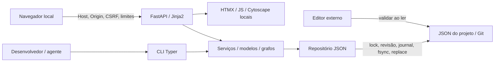

# Arquitetura e decisões

## ADR-009 — Grafo navegável e cálculo explícito de precedência

O cálculo usa passagens topológicas com bitsets para alcance transitivo e CPM
com ida/volta para início, fim e folga. Rotas críticas empatadas são destacadas
sem enumerar todos os caminhos. Um caminho representativo tem desempate estável.
Estimativas incompletas/incompatíveis produzem uma cadeia estrutural declarada,
sem duração inventada. Trabalho restante e projeto completo têm cálculos
separados; cancelados não entram no CPM. As respostas web limitam listas de
bloqueadores, preservando as contagens e o detalhamento do item selecionado.

A web começa com vizinhança limitada em projetos grandes. O layout hierárquico
usa maior precedência, duas passagens baricêntricas e separação de componentes,
sem simulação física ou dependência de CDN. Busca e painel textual mantêm acesso
a itens fora do desenho. Tela inteira tem alternativa por CSS e controle de foco.

Exportação recebe somente posições finitas e limitadas, CSRF e revisão. O núcleo
consulta texto/relações canônicos e gera SVG escapado. PDF divide regiões do
desenho, inclui inventário e usa o worker isolado existente, com limites de
páginas, conteúdo, tempo, memória e acesso a recursos. Nenhuma escrita é exigida
para exportar, inclusive com volume somente leitura. Não se aceita markup do
cliente nem se busca recurso externo. Navegador real permanece como verificação
distinta dos testes DOM com Cytoscape headless.

## ADR-008 — Adoção assistida sem importação destrutiva

A skill de adoção inventaria fontes e produz uma proposta no contrato Backlog.
O helper usa os mesmos modelos, validação estrita e motor de dependências do
produto; publica somente um candidato novo, sem modificar as fontes ou mesclar
armazenamento ativo. Metadados de origem ficam em `extensions`, com mapa de IDs,
hashes e reconciliação. Datas ausentes recebem origem explícita de importação;
datas parciais exigem decisão. Histórico de cards não é convertido em auditoria
retroativa. A referência técnica da skill orienta a primeira adoção e o merge
incremental. A skill também incorpora ao `AGENTS.md` uma rotina de consulta,
atualização de cards/histórico e regeneração do relatório. O runbook do usuário
fica restrito a instalar comando/skill e solicitar a integração ao agente.

Essa entrega é uma migração assistida por agente e um helper de staging; não
implementa conectores ou um parser universal de Markdown/CSV. O pacote ZIP
distribui a skill, suas referências e scripts, e as fontes fictícias de exemplo.

## ADR-007 — Documento gerencial e gráficos portáveis

O relatório deriva de um snapshot validado e da auditoria local disponível. O
serviço compartilha a fonte Markdown entre prévia, downloads e CLI; a action
gera os três formatos a partir da mesma fonte. Não se inventam descrições,
datas, responsáveis nem produtividade para preencher campos ausentes.

Os gráficos usam blocos Mermaid com um comentário de metadados versionado.
Markdown mantém diagramas portáveis; HTML/PDF convertem somente esses metadados
validados em SVG nativo, sem JavaScript, Chromium, HTML arbitrário ou busca de
recursos. O modelo limita séries, amostras, rótulos, cores e valores finitos;
metadados inválidos permanecem código inerte. Textos dos cards são escapados,
inclusive descrições multilinha, e não podem criar novos blocos de gráfico.

SVG preserva lacunas do burndown. Como Mermaid XY não aceita valores nulos,
seus pontos mostram apenas datas observadas, com essa diferença declarada no
documento. Tabelas mantêm os valores disponíveis em todos os formatos. As
sintaxes usadas seguem as referências oficiais de
[pizza](https://mermaid.js.org/syntax/pie.html) e
[XY](https://mermaid.js.org/syntax/xyChart.html).

## ADR-006 — Gráficos, histórico e relatórios reutilizáveis

SVG nativo apresenta distribuição e séries históricas sem nova dependência de
runtime no navegador. Dados vêm do núcleo; não se sintetizam dias anteriores aos
registros. Burndown separa checkpoints observados, intervalos desconhecidos e
referência ideal de uma iteração com datas e baseline reais. A trilha por card
fica no JSON canônico; a auditoria operacional continua separada em .runtime.

Markdown é a fonte compartilhada para documento web, HTML autocontido e PDF.
MarkdownIt desabilita HTML, imagens e links nos dados. WeasyPrint roda em processo
com recursos limitados e fetcher que rejeita recursos externos. Somente /document
permite frame-ancestors self, para a prévia local isolada com sandbox; o restante
da aplicação mantém frame-ancestors none. O modo de impressão abre outra página
com controles locais. Mypy mantém uma exceção de import sem stubs para WeasyPrint.

Uma composite action recebe formatos opcionais, lê um único snapshot sem
permissão de escrita do repositório e publica somente os arquivos produzidos.
Actions novas usam SHAs verificados; o consumidor deve fixar também o SHA do
Backloger após a publicação. Lock de dependências com hashes e execução remota
continuam no fechamento de distribuição de BKL-014. A dependência JSDOM tem
versão exata para testes; não houve resolução de lock npm offline neste ambiente.

## ADR-001 — Núcleo local compartilhado

**Contexto:** projetos em qualquer linguagem precisam adotar o mesmo contrato
sem servidor central. **Decisão:** Python 3.12+, modelos Pydantic v2 e JSON
versionado em Git. Arquivos por atividade são o padrão; arquivo único atende
projetos pequenos. CLI Typer e FastAPI usam `BacklogService`, `Repository` e o
motor NetworkX. **Consequência:** nenhum banco ou estado da interface diverge da
fonte canônica. SQLite fica reservado a índices auxiliares futuros.



Não existe Node ou bundler em produção. JavaScript implementa o editor,
drag-and-drop, filtros e polling; Jinja2 mantém autoescape e HTMX atualiza o
resumo histórico. Descrições são editadas como texto, sem executar HTML ou
Markdown. O exportador Markdown aplica escaping contextual.

## ADR-002 — Consistência e recuperação

**Decisão:** snapshot estável por duas leituras comparadas, versão por atividade,
SHA-256 global e bloqueio cooperativo Portalocker com timeout de 5 segundos.

```mermaid
sequenceDiagram
  participant C as CLI / API
  participant S as Serviço
  participant F as Arquivos
  C->>S: intenção + versão + revisão
  S->>F: ler e validar snapshot
  S->>S: validar referências, ciclos e WIP
  S->>F: adquirir project.lock; comparar snapshot
  S->>F: backup e diário de intenção duráveis
  S->>F: conferir alvo; temporário + fsync + replace + fsync diretório
  S->>F: auditoria durável; remover diário
  S-->>C: nova versão e revisão
```

Cada operação altera um arquivo canônico: backlog completo no modo único,
atividade ou `views.json` no modo dividido. Inicializações publicam um arquivo
completo ou diretório preparado sem substituir projetos existentes.

Um diário pendente bloqueia novas gravações. `recover` conclui a intenção se o
alvo corresponde ao conteúdo anterior, ou finaliza a auditoria se já corresponde
ao posterior. Um terceiro conteúdo causa conflito e permanece intacto. O diário
durável representa uma intenção que poderá ser concluída após falha, mesmo se
o cliente não recebeu sucesso. Backup/auditoria não são logs imutáveis contra
um usuário com controle do filesystem.

**Limite explícito:** não existe CAS universal de arquivos que impeça um editor
que ignore o bloqueio de escrever entre a última comparação e o rename. O
Backloger detecta edições anteriores à comparação, incluindo edições sem mudar
`version`, mas não promete serialização de escritores não cooperativos. Para
garantia estrita, ferramentas externas devem adquirir
`.backloger/.runtime/project.lock`, validar e escrever atomicamente. Merges Git
continuam no fluxo do projeto. Durabilidade é destinada a filesystems locais
com lock/rename/fsync; NFS, SMB, sincronizadores de nuvem e Windows não foram
validados nesta entrega.

## ADR-003 — Segurança HTTP local

Python usa loopback por padrão. Bind 0.0.0.0 na CLI exige `--allow-remote`.
Compose usa esse bind internamente e publica somente 127.0.0.1. O modo local é
de usuário único, sem autenticação de conta. Essa é uma exceção explícita à
regra geral de autenticar APIs: a fronteira é a máquina do usuário. Colaboração
remota não faz parte desta entrega.

Hosts explícitos protegem contra DNS rebinding; Origin e Fetch Metadata
bloqueiam acesso entre sites e um token aleatório por processo protege
mutações. Não existe CORS permissivo ou confiança em headers de proxy. CSP
restringe scripts à origem local e bloqueia frames e objetos. A exceção
`style-src unsafe-inline` atende dimensões e renderização do Cytoscape;
scripts inline continuam proibidos. API, grafos e Compose têm limites.

O projeto é fixado na aplicação; rotas não recebem caminhos de arquivos ou de
projetos. Dados rejeitam traversal e symlinks. Leituras usam O_NOFOLLOW quando
disponível, limitam bytes e rejeitam arquivos especiais. Um processo hostil do
mesmo usuário pode mudar paths e permissões durante a execução; esse caso
exige isolamento do sistema operacional.

Somente leitura é aplicado no repositório e, por uma mesma configuração do
Compose, também no volume. A imagem tem root filesystem somente leitura e
/tmp limitado. O serviço executa sem privilégios, capabilities ou escalada.

## ADR-004 — Métricas observadas

Categorias padronizadas permitem comparar estados configuráveis. Bloqueadores
são pré-requisitos transitivos ainda não concluídos/cancelados. Caminho crítico
soma pesos de nós em DAG quando todas as estimativas têm a mesma unidade;
não converte pontos em dias e não prevê calendário. Gargalos classificam impacto
transitivo. Throughput conta IDs concluídos uma vez na janela de 7 dias segundo
eventos do Backloger. Edições externas não geram história retroativa.

## ADR-005 — Distribuição e exceções da fundação

O pacote local de instalação reúne wheel, fonte, instalador Python, guias,
exemplos, schemas, SBOM e manifesto de integridade, com seleção explícita de
arquivos. O instalador verifica os hashes antes de criar o venv, não usa o
Python global e aceita dependências locais por `--wheelhouse`. O ZIP não
contém wheels de dependências nem interpretador. O ambiente de instalação pode
diferir do inventário capturado no build. Artefatos locais não têm assinatura
ou provenance de CI: essa é uma exceção desta entrega local, sem publicação,
e permanece no fechamento de BKL-014. Checksum não autentica o distribuidor.

Hatchling gera wheel/sdist com assets locais e licenças. Runtime/dev são
separados e dependências têm major limitado. SBOM SPDX inventaria a árvore
instalada e gera versões exatas para pip-audit. Lock de distribuição com hashes,
imagens por digest seguem em BKL-014 antes da release pública; actions agora estão fixadas em SHA:
a rede deste ambiente impediu resolver/verificar esses artefatos. Não se
apresenta um lock parcial como distribuição reproduzível.

Mypy strict cobre o código Python. Há uma exceção limitada de import sem stubs
para NetworkX; suas entradas/saídas são exercitadas nos testes de grafos e
validadas no núcleo. As demais bibliotecas tipadas mantêm verificação estrita.
