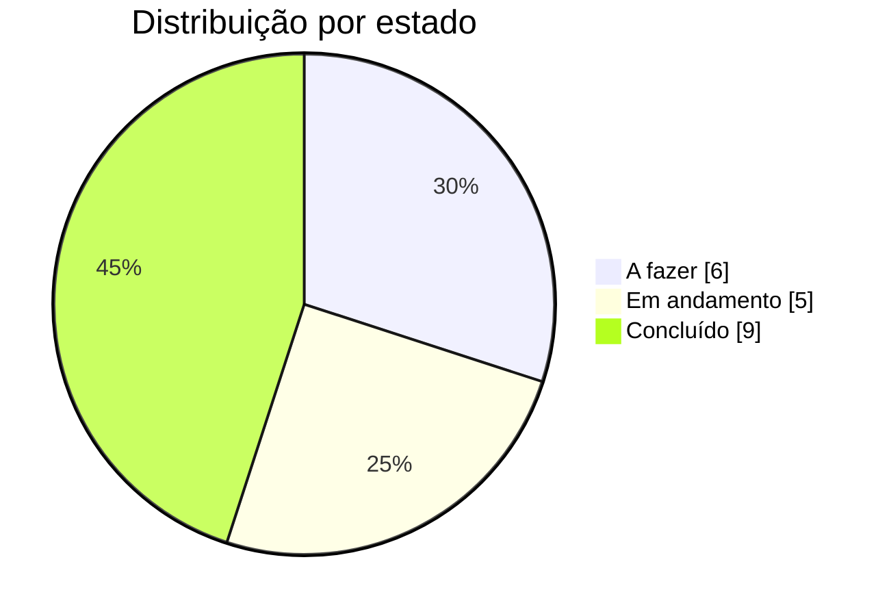
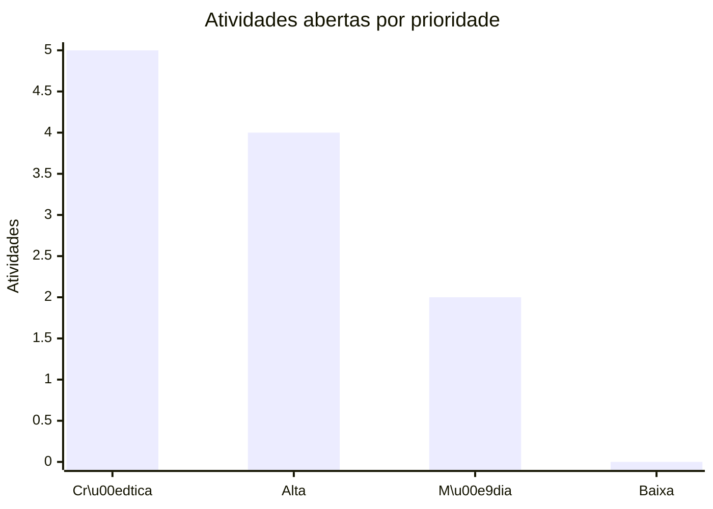

# Backlog — Backloger

Relatório gerencial de acompanhamento de status

**Projeto:** BKL · **Referência:** 2026-11-13 (UTC) · **Contrato:** 1.0.0

Dados canônicos do projeto, consolidados para acompanhamento de execução, priorização e decisões de entrega.

**Conteúdo:** Resumo executivo · Distribuição e capacidade · Evolução e burndown · Marcos e iterações · Dependências e próximas ações · Inventário · Detalhamento das atividades · Histórico · Critérios de leitura

## 1. Resumo executivo

**Situação geral: Atenção necessária.** O projeto reúne 20 atividades: 9 concluídas, 5 em execução/revisão, 6 aguardando início e 0 canceladas. O avanço do escopo válido é de **45%**.

| Indicador | Resultado | Leitura gerencial |
| --- | --- | --- |
| Conclusão do escopo | 45% | Concluídas ÷ total não cancelado |
| Atividades abertas | 11 | Aguardando início ou em execução/revisão |
| Bloqueadas | 3 | Dependem de pré-requisitos ainda abertos |
| Prazos vencidos | 0 | Abertas com data anterior à referência |
| Entregas nos últimos 7 dias | 0 | Atividades distintas concluídas em eventos observados; não é previsão |
| Critérios de aceite | Não definidos | Critérios marcados como atendidos ÷ cadastrados |

### Pontos de atenção e encaminhamentos

- **Desbloquear o fluxo:** 3 atividades aguardam pré-requisitos; priorizar os bloqueadores apresentados na seção de dependências.
- **Definir responsáveis:** 11 atividades abertas sem essa informação.
- **Definir datas de entrega:** 11 atividades abertas sem essa informação.
- **Completar critérios de aceite:** 11 atividades abertas sem essa informação.

> Percentual por quantidade de atividades, sem ponderação por esforço. Ausência de prazo não comprova que uma atividade esteja dentro do prazo.

## 2. Distribuição e capacidade

### Situação das atividades



| Estado | Quantidade | % do total | Limite WIP |
| --- | --- | --- | --- |
| A fazer | 6 | 30% | Não definido |
| Em andamento | 5 | 25% | Não definido |
| Em revisão | 0 | 0% | Não definido |
| Concluído | 9 | 45% | Não definido |
| Cancelado | 0 | 0% | Não definido |

### Prioridade do trabalho aberto



| Prioridade | Abertas | Bloqueadas | Vencidas |
| --- | --- | --- | --- |
| Crítica | 5 | 0 | 0 |
| Alta | 4 | 1 | 0 |
| Média | 2 | 2 | 0 |
| Baixa | 0 | 0 | 0 |

### Distribuição por responsável

| Responsável | Total | Abertas | Concluídas | Bloqueadas |
| --- | --- | --- | --- | --- |
| Sem responsável | 20 | 11 | 9 | 3 |

## 3. Evolução e burndown

### Burndown do projeto — últimos 30 dias

```mermaid
%% backloger-chart-v1 {"kind":"line","title":"Burndown · atividades restantes","labels":["10-15","10-16","10-17","10-18","10-19","10-20","10-21","10-22","10-23","10-24","10-25","10-26","10-27","10-28","10-29","10-30","10-31","11-01","11-02","11-03","11-04","11-05","11-06","11-07","11-08","11-09","11-10","11-11","11-12","11-13"],"series":[{"name":"Restantes","values":[null,null,null,null,null,null,null,null,null,null,null,null,null,null,null,null,null,null,null,null,null,null,null,null,null,null,null,11.0,null,11.0]}],"colors":[]}
xychart-beta
    title "Burndown #183; atividades restantes"
    x-axis ["11-11", "11-13"]
    y-axis "Atividades" 0 --> 11
    line [11, 11]
```

**Saldo atual: 11 atividades abertas.** Há 2 dia(s) com observação nesta janela. Dias sem checkpoint ficam sem valor; não há reconstrução retroativa. Novas atividades, reaberturas e cancelamentos podem alterar a curva.

| Data observada (UTC) | Restantes | Escopo total |
| --- | --- | --- |
| 2026-11-11 | 11 | 20 |
| 2026-11-13 | 11 | 20 |

### Ritmo de entrega — últimos 7 dias

```mermaid
%% backloger-chart-v1 {"kind":"bar","title":"Entradas e conclusões observadas","labels":["11-07","11-08","11-09","11-10","11-11","11-12","11-13"],"series":[{"name":"Criadas","values":[0.0,0.0,0.0,0.0,0.0,0.0,0.0]},{"name":"Concluídas","values":[0.0,0.0,0.0,0.0,0.0,0.0,0.0]}],"colors":[]}
xychart-beta
    title "Entradas e conclusões observadas"
    x-axis ["11-07", "11-08", "11-09", "11-10", "11-11", "11-12", "11-13"]
    y-axis "Atividades" 0 --> 1
    bar [0, 0, 0, 0, 0, 0, 0]
    bar [0, 0, 0, 0, 0, 0, 0]
```



| Data (UTC) | Criadas | Concluídas |
| --- | --- | --- |
| 2026-11-07 | 0 | 0 |
| 2026-11-08 | 0 | 0 |
| 2026-11-09 | 0 | 0 |
| 2026-11-10 | 0 | 0 |
| 2026-11-11 | 0 | 0 |
| 2026-11-12 | 0 | 0 |
| 2026-11-13 | 0 | 0 |

> Somente eventos registrados pelo Backloger. Edições externas não são reconstruídas. Datas em UTC.

Auditoria observada desde 2026-11-11T15:19:44.954495+00:00. Eventos na janela de 30 dias: 24. Períodos anteriores ao início dos registros não comprovam ausência de atividade.

## 4. Marcos e iterações

### Entregas por marco

```mermaid
%% backloger-chart-v1 {"kind":"bar","title":"Conclusões e pendências por marco","labels":["M1","M2","M3"],"series":[{"name":"Concluídas","values":[9.0,0.0,0.0]},{"name":"Abertas","values":[5.0,4.0,2.0]}],"colors":[]}
xychart-beta
    title "Conclusões e pendências por marco"
    x-axis ["M1", "M2", "M3"]
    y-axis "Atividades" 0 --> 9
    bar [9, 0, 0]
    bar [5, 4, 2]
```



O gráfico considera até 20 marcos, na ordem cadastrada, e exclui cancelados. A tabela apresenta todos os marcos.

### Marcos de entrega

| Entrega | Prazo | Atividades | Conclusão | Situação |
| --- | --- | --- | --- | --- |
| M1 · Primeira versão utilizável | Não definido | 14 | 64% | Em aberto |
| M2 · Integrações e colaboração | Não definido | 4 | 0% | Em aberto |
| M3 · Múltiplos projetos | Não definido | 2 | 0% | Em aberto |

### Iterações

Nenhum registro cadastrado.

11 atividades abertas ainda sem vínculo com iterações.

## 5. Dependências e próximas ações

### Bloqueios que exigem atuação

| Atividade bloqueada | Responsável | Pré-requisitos ainda abertos |
| --- | --- | --- |
| BKL-015 · Roadmap, timeline e relatórios avançados | Não definido | BKL-009 · Dashboard e Kanban |
| BKL-019 · Instância centralizada multiprojeto | Não definido | BKL-017 · Autenticação e colaboração multiusuário |
| BKL-020 · Dependências entre projetos | Não definido | BKL-017 · Autenticação e colaboração multiusuário; BKL-019 · Instância centralizada multiprojeto |

### Maiores impactos potenciais

| Pré-requisito | Estado | Atividades alcançadas |
| --- | --- | --- |
| BKL-017 · Autenticação e colaboração multiusuário | A fazer | 2 |

Impacto considera todos os sucessores do grafo, inclusive itens já encerrados.

**Maior cadeia de precedência restante:** BKL-017 → BKL-019 → BKL-020 · 3 atividades. 11 atividades sem estimativa neste escopo. Não é uma previsão de duração; complete estimativas na mesma unidade para calcular o caminho crítico técnico.

### Próximas ações sem bloqueio de dependência

Seleção por prioridade, prazo e ID. Confirme capacidade e contexto antes de iniciar.

| Atividade | Prioridade | Estado | Responsável | Prazo |
| --- | --- | --- | --- | --- |
| BKL-009 · Dashboard e Kanban | Crítica | Em andamento | Não definido | Não definido |
| BKL-010 · Visualizador de grafos | Crítica | Em andamento | Não definido | Não definido |
| BKL-011 · Sincronização de alterações externas | Crítica | Em andamento | Não definido | Não definido |
| BKL-013 · Docker Compose e Makefile | Crítica | Em andamento | Não definido | Não definido |
| BKL-014 · Testes, CI e documentação | Crítica | Em andamento | Não definido | Não definido |
| BKL-016 · Integrações GitHub e GitLab | Alta | A fazer | Não definido | Não definido |
| BKL-017 · Autenticação e colaboração multiusuário | Alta | A fazer | Não definido | Não definido |
| BKL-018 · Importadores e plugins | Alta | A fazer | Não definido | Não definido |

## 6. Inventário de atividades

| ID | Atividade | Estado | Prioridade | Responsável | Prazo |
| --- | --- | --- | --- | --- | --- |
| BKL-001 | Estrutura do projeto e empacotamento Python | Concluído | Crítica | Não definido | Não definido |
| BKL-002 | JSON Schema oficial e exemplos | Concluído | Crítica | Não definido | Não definido |
| BKL-003 | Modelos de domínio e validação | Concluído | Crítica | Não definido | Não definido |
| BKL-004 | Persistência JSON e escrita atômica | Concluído | Crítica | Não definido | Não definido |
| BKL-005 | CLI completo | Concluído | Crítica | Não definido | Não definido |
| BKL-006 | Motor de dependências e análise de grafos | Concluído | Crítica | Não definido | Não definido |
| BKL-007 | Geradores Markdown, CSV e Mermaid | Concluído | Crítica | Não definido | Não definido |
| BKL-008 | API FastAPI | Concluído | Crítica | Não definido | Não definido |
| BKL-009 | Dashboard e Kanban | Em andamento | Crítica | Não definido | Não definido |
| BKL-010 | Visualizador de grafos | Em andamento | Crítica | Não definido | Não definido |
| BKL-011 | Sincronização de alterações externas | Em andamento | Crítica | Não definido | Não definido |
| BKL-012 | Segurança web local | Concluído | Crítica | Não definido | Não definido |
| BKL-013 | Docker Compose e Makefile | Em andamento | Crítica | Não definido | Não definido |
| BKL-014 | Testes, CI e documentação | Em andamento | Crítica | Não definido | Não definido |
| BKL-015 | Roadmap, timeline e relatórios avançados | A fazer | Alta | Não definido | Não definido |
| BKL-016 | Integrações GitHub e GitLab | A fazer | Alta | Não definido | Não definido |
| BKL-017 | Autenticação e colaboração multiusuário | A fazer | Alta | Não definido | Não definido |
| BKL-018 | Importadores e plugins | A fazer | Alta | Não definido | Não definido |
| BKL-019 | Instância centralizada multiprojeto | A fazer | Média | Não definido | Não definido |
| BKL-020 | Dependências entre projetos | A fazer | Média | Não definido | Não definido |

## 7. Detalhamento das atividades

### BKL-001 — Estrutura do projeto e empacotamento Python

| Campo | Informação | Campo | Informação |
| --- | --- | --- | --- |
| Estado | Concluído | Prioridade | Crítica |
| Tipo | Funcionalidade | Responsável | Não definido |
| Componente | Não definido | Prazo | Não definido |
| Marco | Primeira versão utilizável | Iteração | Não definida |
| Estimativa | Não definida | Versão | 2 |
| Criação (UTC) | 2026-11-11 13:23 | Atualização (UTC) | 2026-11-11 15:19 |

**Leitura de acompanhamento:** Concluída.

**Descrição e escopo**

> Objetivo: distribuir o Backloger como produto Python independente, instalável uma única vez e reutilizável em repositórios de qualquer linguagem.
> 
> Entrega disponível: estrutura src/backloger, empacotamento Hatchling, ponto de entrada backloger, dependências de runtime/dev separadas, wheel e sdist com templates, assets, licenças e schemas. A instalação do wheel e a criação da API foram verificadas localmente. Publicação em PyPI/registry e distribuição reproduzível fazem parte do fechamento de BKL-014.

**Critérios de aceite**

Nenhum critério de aceite cadastrado.

**Dependências e relações**

Nenhuma relação declarada neste card.

**Etiquetas:** p0

**Último registro de acompanhamento**

2026-11-11T15:19:44.952995+00:00 · v2 · Atualizados: Descrição.

### BKL-002 — JSON Schema oficial e exemplos

| Campo | Informação | Campo | Informação |
| --- | --- | --- | --- |
| Estado | Concluído | Prioridade | Crítica |
| Tipo | Funcionalidade | Responsável | Não definido |
| Componente | Não definido | Prazo | Não definido |
| Marco | Primeira versão utilizável | Iteração | Não definida |
| Estimativa | Não definida | Versão | 2 |
| Criação (UTC) | 2026-11-11 13:23 | Atualização (UTC) | 2026-11-11 15:19 |

**Leitura de acompanhamento:** Concluída.

**Descrição e escopo**

> Objetivo: publicar o contrato JSON 1.0.0 para projetos, atividades e backlog completo, permitindo adoção sem dependência da linguagem da aplicação.
> 
> Entrega disponível: JSON Schemas gerados dos modelos Pydantic, exemplos de armazenamento dividido e único, referências de marcos/iterações e campos extensíveis. schema\_version identifica o formato; version controla concorrência por atividade. A suíte verifica validade dos schemas e compatibilidade dos exemplos; o modo estrito identifica campos fora do contrato, preservando extensões declaradas.

**Critérios de aceite**

Nenhum critério de aceite cadastrado.

**Dependências e relações**

- Depende de **BKL-001** · Estrutura do projeto e empacotamento Python

**Etiquetas:** p0

**Último registro de acompanhamento**

2026-11-11T15:19:44.980522+00:00 · v2 · Atualizados: Descrição.

### BKL-003 — Modelos de domínio e validação

| Campo | Informação | Campo | Informação |
| --- | --- | --- | --- |
| Estado | Concluído | Prioridade | Crítica |
| Tipo | Funcionalidade | Responsável | Não definido |
| Componente | Não definido | Prazo | Não definido |
| Marco | Primeira versão utilizável | Iteração | Não definida |
| Estimativa | Não definida | Versão | 2 |
| Criação (UTC) | 2026-11-11 13:23 | Atualização (UTC) | 2026-11-11 15:19 |

**Leitura de acompanhamento:** Concluída.

**Descrição e escopo**

> Objetivo: centralizar as regras de domínio consumidas pela CLI, API e futuras integrações.
> 
> Entrega disponível: modelos para projetos, estados configuráveis, atividades, estimativas, critérios de aceite, dependências, marcos, iterações, visões e histórico dos cards. A validação verifica identificadores, limites, datas com fuso, estados e referências; rejeita ciclos e inconsistências. Campos desconhecidos dos arquivos são preservados nas edições normais, enquanto requisições de mutação usam contratos restritos.

**Critérios de aceite**

Nenhum critério de aceite cadastrado.

**Dependências e relações**

- Depende de **BKL-002** · JSON Schema oficial e exemplos

**Etiquetas:** p0

**Último registro de acompanhamento**

2026-11-11T15:19:45.005943+00:00 · v2 · Atualizados: Descrição.

### BKL-004 — Persistência JSON e escrita atômica

| Campo | Informação | Campo | Informação |
| --- | --- | --- | --- |
| Estado | Concluído | Prioridade | Crítica |
| Tipo | Funcionalidade | Responsável | Não definido |
| Componente | Não definido | Prazo | Não definido |
| Marco | Primeira versão utilizável | Iteração | Não definida |
| Estimativa | Não definida | Versão | 2 |
| Criação (UTC) | 2026-11-11 13:23 | Atualização (UTC) | 2026-11-11 15:19 |

**Leitura de acompanhamento:** Concluída.

**Descrição e escopo**

> Objetivo: manter os JSONs do projeto como fonte canônica sem perder alterações da interface, CLI ou editor externo.
> 
> Entrega disponível: escrita atômica com fsync, lock cooperativo, revisão global por conteúdo, versão por atividade, backups, diário de intenção, auditoria e recuperação explícita. Testes exercitam gravações concorrentes, falhas antes/depois da substituição e recuperação de conteúdo válido. Editores que ignoram o lock continuam sujeitos ao limite de concorrência documentado; não há promessa de serialização universal de arquivos.

**Critérios de aceite**

Nenhum critério de aceite cadastrado.

**Dependências e relações**

- Depende de **BKL-003** · Modelos de domínio e validação

**Etiquetas:** p0

**Último registro de acompanhamento**

2026-11-11T15:19:45.033881+00:00 · v2 · Atualizados: Descrição.

### BKL-005 — CLI completo

| Campo | Informação | Campo | Informação |
| --- | --- | --- | --- |
| Estado | Concluído | Prioridade | Crítica |
| Tipo | Funcionalidade | Responsável | Não definido |
| Componente | Não definido | Prazo | Não definido |
| Marco | Primeira versão utilizável | Iteração | Não definida |
| Estimativa | Não definida | Versão | 2 |
| Criação (UTC) | 2026-11-11 13:23 | Atualização (UTC) | 2026-11-11 15:19 |

**Leitura de acompanhamento:** Concluída.

**Descrição e escopo**

> Objetivo: operar o backlog sem iniciar a interface web e permitir automações com saída estruturada.
> 
> Entrega disponível: inicialização, criação, consulta, edição, movimentação, dependências, validação estrita, análise de bloqueios, relatórios, diagnóstico, backups e recuperação. Há seleção de projeto, saída JSON, códigos de retorno documentados, autocomplete e servidor local. Exportações Markdown, HTML e PDF compartilham o relatório gerencial; CSV, Mermaid e SVG atendem integrações e documentação técnica.

**Critérios de aceite**

Nenhum critério de aceite cadastrado.

**Dependências e relações**

- Depende de **BKL-004** · Persistência JSON e escrita atômica

**Etiquetas:** p0

**Último registro de acompanhamento**

2026-11-11T15:19:45.059652+00:00 · v2 · Atualizados: Descrição.

### BKL-006 — Motor de dependências e análise de grafos

| Campo | Informação | Campo | Informação |
| --- | --- | --- | --- |
| Estado | Concluído | Prioridade | Crítica |
| Tipo | Funcionalidade | Responsável | Não definido |
| Componente | Não definido | Prazo | Não definido |
| Marco | Primeira versão utilizável | Iteração | Não definida |
| Estimativa | Não definida | Versão | 3 |
| Criação (UTC) | 2026-11-11 13:23 | Atualização (UTC) | 2026-11-13 18:45 |

**Leitura de acompanhamento:** Concluída.

**Descrição e escopo**

> Objetivo: transformar as relações de precedência em análise prática de execução e impacto.
> 
> Entrega disponível: grafo dirigido de pré-requisito para dependente, referências/ciclos validados, isolados, bloqueadores transitivos, itens prontos e gargalos. Alcance usa bitsets e passagens topológicas; respostas HTTP limitam listas, mantendo contagens exatas. CPM de ida/volta calcula início, fim, folga e todas as rotas críticas empatadas, com caminho representativo estável e escopos de projeto/trabalho restante. Estimativas incompletas ou em unidades diferentes mostram a maior cadeia estrutural e o motivo, sem duração inventada. Estimativas técnicas não representam previsão de calendário.
> 
> Validação: rotas paralelas, folga, zero/frações, encerrados, unidades diferentes e DAG aleatório comparado ao NetworkX. Ensaio com 2.000 atividades/9.985 relações preservou a cadeia completa e contagens exatas.

**Critérios de aceite**

Nenhum critério de aceite cadastrado.

**Dependências e relações**

- Depende de **BKL-003** · Modelos de domínio e validação

**Etiquetas:** p0

**Último registro de acompanhamento**

2026-11-13T18:45:36.150765+00:00 · v3 · Motor atualizado com bitsets, CPM de ida/volta, rotas empatadas e escopos restante/completo. Cadeia estrutural explícita quando faltam estimativas. Casos novos e suíte completa aprovados; teste no limite contratual de 2.000 atividades e 9.985 relações.

### BKL-007 — Geradores Markdown, CSV e Mermaid

| Campo | Informação | Campo | Informação |
| --- | --- | --- | --- |
| Estado | Concluído | Prioridade | Crítica |
| Tipo | Funcionalidade | Responsável | Não definido |
| Componente | Não definido | Prazo | Não definido |
| Marco | Primeira versão utilizável | Iteração | Não definida |
| Estimativa | Não definida | Versão | 2 |
| Criação (UTC) | 2026-11-11 13:23 | Atualização (UTC) | 2026-11-11 15:19 |

**Leitura de acompanhamento:** Concluída.

**Descrição e escopo**

> Objetivo: produzir documentação de acompanhamento que possa ser revisada no Git, compartilhada e consumida por outras ferramentas.
> 
> Entrega disponível: relatório gerencial com resumo executivo, indicadores, alertas, distribuição por estado/prioridade, burndown, ritmo de entrega, marcos, próximas ações e ficha completa de cada atividade. Markdown usa Mermaid; HTML e PDF incorporam gráficos vetoriais sem rede ou navegador. Inclui descrições, critérios de aceite, dependências e histórico. CSV protege células de fórmulas; Mermaid e SVG também podem ser exportados separadamente.

**Critérios de aceite**

Nenhum critério de aceite cadastrado.

**Dependências e relações**

- Depende de **BKL-006** · Motor de dependências e análise de grafos

**Etiquetas:** p0

**Último registro de acompanhamento**

2026-11-11T15:19:45.111883+00:00 · v2 · Atualizados: Descrição.

### BKL-008 — API FastAPI

| Campo | Informação | Campo | Informação |
| --- | --- | --- | --- |
| Estado | Concluído | Prioridade | Crítica |
| Tipo | Funcionalidade | Responsável | Não definido |
| Componente | Não definido | Prazo | Não definido |
| Marco | Primeira versão utilizável | Iteração | Não definida |
| Estimativa | Não definida | Versão | 2 |
| Criação (UTC) | 2026-11-11 13:23 | Atualização (UTC) | 2026-11-11 15:19 |

**Leitura de acompanhamento:** Concluída.

**Descrição e escopo**

> Objetivo: oferecer uma API local que consuma as mesmas regras e persistência da CLI.
> 
> Entrega disponível: FastAPI com consulta do estado, criação/edição de atividades, visões salvas, análise de grafo, prévia de documento e downloads Markdown/HTML/PDF/CSV/Mermaid/SVG. Mutações exigem revisão If-Match, versão e token local. Há documentação HTTP local e contrato OpenAPI. Testes cobrem operações, erros, conflitos, leitura após edição externa e modo somente leitura.

**Critérios de aceite**

Nenhum critério de aceite cadastrado.

**Dependências e relações**

- Depende de **BKL-004** · Persistência JSON e escrita atômica

**Etiquetas:** p0

**Último registro de acompanhamento**

2026-11-11T15:19:45.138913+00:00 · v2 · Atualizados: Descrição.

### BKL-009 — Dashboard e Kanban

| Campo | Informação | Campo | Informação |
| --- | --- | --- | --- |
| Estado | Em andamento | Prioridade | Crítica |
| Tipo | Funcionalidade | Responsável | Não definido |
| Componente | Não definido | Prazo | Não definido |
| Marco | Primeira versão utilizável | Iteração | Não definida |
| Estimativa | Não definida | Versão | 2 |
| Criação (UTC) | 2026-11-11 13:23 | Atualização (UTC) | 2026-11-11 15:19 |

**Leitura de acompanhamento:** Sem bloqueio de dependência.

**Descrição e escopo**

> Objetivo: acompanhar e operar o projeto por dashboard e Kanban, com filtros e feedback das gravações.
> 
> Entrega disponível: indicadores, gráficos de estado/prioridade/responsável, atividade histórica, burndown, quadro com drag-and-drop, editor, critérios de aceite, notas e histórico por card. Há limites WIP, filtros, visões salvas, tratamento de conflitos e exportações. Testes DOM exercitam as interações e o núcleo; falta homologação visual e funcional em Chromium real num ambiente que permita sua execução. Por isso a entrega permanece em andamento.

**Critérios de aceite**

Nenhum critério de aceite cadastrado.

**Dependências e relações**

- Depende de **BKL-008** · API FastAPI

**Etiquetas:** p0

**Último registro de acompanhamento**

2026-11-11T15:19:45.167888+00:00 · v2 · Atualizados: Descrição.

### BKL-010 — Visualizador de grafos

| Campo | Informação | Campo | Informação |
| --- | --- | --- | --- |
| Estado | Em andamento | Prioridade | Crítica |
| Tipo | Funcionalidade | Responsável | Não definido |
| Componente | Não definido | Prazo | Não definido |
| Marco | Primeira versão utilizável | Iteração | Não definida |
| Estimativa | Não definida | Versão | 3 |
| Criação (UTC) | 2026-11-11 13:23 | Atualização (UTC) | 2026-11-13 18:45 |

**Leitura de acompanhamento:** Sem bloqueio de dependência.

**Descrição e escopo**

> Objetivo: investigar dependências, bloqueadores e impacto com leitura viável em projetos grandes.
> 
> Entrega disponível: Cytoscape.js local, tela inteira com alternativa CSS/teclado, busca por ID/título em todo o escopo, recortes automáticos de até 180 nós, panorama, vizinhança, pré-requisitos e impactos. Layout hierárquico por maior precedência, agrupamento de componentes, direções e rótulos adaptáveis. Painel textual lista relações transitivas 30 por vez e permite abrir cards. Destaque de todas as rotas sem folga, duração técnica/folga quando há estimativas compatíveis e orientação para completar estimativas ausentes. Atualizações preservam pan/zoom se a topologia não muda.
> 
> Exportação da visão em SVG e PDF A4 paisagem: panorama, regiões legíveis e inventário com títulos/estados/pré-requisitos, inclusive externos ao recorte. Texto e relações canônicos, revisão e CSRF, sem gravação; funciona em modo somente leitura. PDF compartilha o worker isolado existente.
> 
> Validação: 14 testes DOM, casos de API/PDF nos dois armazenamentos e inspeção raster do PDF. Pendência: interação/diagramação em navegador real; Chromium foi bloqueado pelo sandbox deste ambiente.

**Critérios de aceite**

Nenhum critério de aceite cadastrado.

**Dependências e relações**

- Depende de **BKL-006** · Motor de dependências e análise de grafos
- Depende de **BKL-008** · API FastAPI

**Etiquetas:** p0

**Último registro de acompanhamento**

2026-11-13T18:45:39.769225+00:00 · v3 · Entregues tela inteira, busca, recortes para grafos grandes, hierarquia por maior precedência, rotas críticas/estimativas e exportação SVG/PDF paginada. 14 testes DOM e API/PDF passaram; panorama e região do PDF inspecionados. Homologação em Chromium segue pendente por bloqueio do sandbox.

### BKL-011 — Sincronização de alterações externas

| Campo | Informação | Campo | Informação |
| --- | --- | --- | --- |
| Estado | Em andamento | Prioridade | Crítica |
| Tipo | Funcionalidade | Responsável | Não definido |
| Componente | Não definido | Prazo | Não definido |
| Marco | Primeira versão utilizável | Iteração | Não definida |
| Estimativa | Não definida | Versão | 2 |
| Criação (UTC) | 2026-11-11 13:23 | Atualização (UTC) | 2026-11-11 15:19 |

**Leitura de acompanhamento:** Sem bloqueio de dependência.

**Descrição e escopo**

> Objetivo: refletir edições externas dos JSONs na aplicação e impedir que um formulário antigo sobrescreva dados concorrentes.
> 
> Entrega disponível: polling por revisão de conteúdo/ETag, leitura de snapshots estáveis, atualização de indicadores e documento, controle otimista e aviso de conflito preservando o formulário. Edições externas são detectadas mesmo sem incremento de version e campos desconhecidos sobrevivem às alterações válidas. API, persistência e cenários DOM foram exercitados; falta o fluxo completo em navegador real. Não se reconstrói auditoria histórica de edições externas.

**Critérios de aceite**

Nenhum critério de aceite cadastrado.

**Dependências e relações**

- Depende de **BKL-004** · Persistência JSON e escrita atômica
- Depende de **BKL-008** · API FastAPI

**Etiquetas:** p0

**Último registro de acompanhamento**

2026-11-11T15:19:45.224644+00:00 · v2 · Atualizados: Descrição.

### BKL-012 — Segurança web local

| Campo | Informação | Campo | Informação |
| --- | --- | --- | --- |
| Estado | Concluído | Prioridade | Crítica |
| Tipo | Funcionalidade | Responsável | Não definido |
| Componente | Não definido | Prazo | Não definido |
| Marco | Primeira versão utilizável | Iteração | Não definida |
| Estimativa | Não definida | Versão | 2 |
| Criação (UTC) | 2026-11-11 13:23 | Atualização (UTC) | 2026-11-11 15:19 |

**Leitura de acompanhamento:** Concluída.

**Descrição e escopo**

> Objetivo: proteger a aplicação local, os arquivos autorizados e a renderização de conteúdo do backlog.
> 
> Entrega disponível: bind loopback por padrão, hosts explícitos, checagem de Origin/Fetch Metadata, token contra CSRF, limites de corpo/grafo e proteção contra traversal/symlinks. Conteúdo dos cards é escapado; a prévia usa iframe isolado. PDF roda em processo limitado e não busca URLs ou arquivos externos. Modo somente leitura impede mutações no repositório. Autenticação remota/multiusuário fica em BKL-017; auditoria online das dependências segue em BKL-014.

**Critérios de aceite**

Nenhum critério de aceite cadastrado.

**Dependências e relações**

- Depende de **BKL-008** · API FastAPI

**Etiquetas:** p0

**Último registro de acompanhamento**

2026-11-11T15:19:45.259984+00:00 · v2 · Atualizados: Descrição.

### BKL-013 — Docker Compose e Makefile

| Campo | Informação | Campo | Informação |
| --- | --- | --- | --- |
| Estado | Em andamento | Prioridade | Crítica |
| Tipo | Funcionalidade | Responsável | Não definido |
| Componente | Não definido | Prazo | Não definido |
| Marco | Primeira versão utilizável | Iteração | Não definida |
| Estimativa | Não definida | Versão | 2 |
| Criação (UTC) | 2026-11-11 13:23 | Atualização (UTC) | 2026-11-11 15:19 |

**Leitura de acompanhamento:** Sem bloqueio de dependência.

**Descrição e escopo**

> Objetivo: executar e automatizar o Backloger por contêiner e comandos Make funcionais.
> 
> Entrega disponível: Dockerfile, Compose normal/dev, .dockerignore, .env.example e alvos para instalação, análise, testes, relatórios, pacote, diagnóstico e operação Docker. A configuração usa usuário sem privilégios, publicação em 127.0.0.1, filesystem raiz somente leitura e volume do projeto com opção de leitura apenas. Compose foi validado sintaticamente; execução e smoke test do contêiner permanecem pendentes de acesso ao daemon Docker.

**Critérios de aceite**

Nenhum critério de aceite cadastrado.

**Dependências e relações**

- Depende de **BKL-001** · Estrutura do projeto e empacotamento Python

**Etiquetas:** p0

**Último registro de acompanhamento**

2026-11-11T15:19:45.332980+00:00 · v2 · Atualizados: Descrição.

### BKL-014 — Testes, CI e documentação

| Campo | Informação | Campo | Informação |
| --- | --- | --- | --- |
| Estado | Em andamento | Prioridade | Crítica |
| Tipo | Funcionalidade | Responsável | Não definido |
| Componente | Não definido | Prazo | Não definido |
| Marco | Primeira versão utilizável | Iteração | Não definida |
| Estimativa | Não definida | Versão | 4 |
| Criação (UTC) | 2026-11-11 13:23 | Atualização (UTC) | 2026-11-13 18:45 |

**Leitura de acompanhamento:** Sem bloqueio de dependência.

**Descrição e escopo**

> Objetivo: demonstrar a confiabilidade da entrega e preparar sua adoção por outros projetos.
> 
> Entrega disponível: testes de domínio, arquivos, concorrência, recuperação, API/CLI, segurança, documentos/PDF e interface DOM; lint, tipos, schemas, empacotamento e SBOM. CI inclui navegador, Docker e uma composite action importável para relatórios opcionais Markdown/HTML/PDF, com manifesto SHA-256. Documentação cobre contrato, operação, arquitetura e limites. Pendências: CI remota, navegador real, Docker, auditoria online, locks com hashes e publicação da distribuição.

**Critérios de aceite**

Nenhum critério de aceite cadastrado.

**Dependências e relações**

- Depende de **BKL-005** · CLI completo
- Depende de **BKL-006** · Motor de dependências e análise de grafos
- Depende de **BKL-007** · Geradores Markdown, CSV e Mermaid
- Depende de **BKL-008** · API FastAPI

**Etiquetas:** p0

**Último registro de acompanhamento**

2026-11-13T18:45:45.394254+00:00 · v4 · Evolução de dependências documentada em DEPENDENCIES, contrato, arquitetura e operação. make check: 117 testes Python, Ruff e Mypy aprovados; 14 testes DOM aprovados. PDF real validado e inspecionado, limite de 2.000 nós/9.985 relações exercitado. E2E ampliado; Chromium bloqueado ao iniciar. Relatórios e pacote local atualizados; navegador real, Docker, CI remota e auditoria online continuam pendentes.

### BKL-015 — Roadmap, timeline e relatórios avançados

| Campo | Informação | Campo | Informação |
| --- | --- | --- | --- |
| Estado | A fazer | Prioridade | Alta |
| Tipo | Funcionalidade | Responsável | Não definido |
| Componente | Não definido | Prazo | Não definido |
| Marco | Integrações e colaboração | Iteração | Não definida |
| Estimativa | Não definida | Versão | 2 |
| Criação (UTC) | 2026-11-11 13:23 | Atualização (UTC) | 2026-11-11 15:19 |

**Leitura de acompanhamento:** Bloqueada por BKL-009.

**Descrição e escopo**

> Objetivo: ampliar a visão de planejamento e acompanhamento com roadmap, timeline e relatórios avançados.
> 
> Escopo já disponível: visão básica de milestones e relatório gerencial com progresso por marco/iteração, burndown observado, referência ideal quando há baseline e detalhes das atividades. Evolução ainda aberta: timeline de calendário, comparação entre períodos, tendências e recursos avançados de planejamento. Previsões devem declarar dados insuficientes e separar esforço estimado de datas reais. A atividade permanece aberta; o relatório atual não encerra todo esse escopo.

**Critérios de aceite**

Nenhum critério de aceite cadastrado.

**Dependências e relações**

- Depende de **BKL-009** · Dashboard e Kanban

**Etiquetas:** p1

**Último registro de acompanhamento**

2026-11-11T15:19:45.394417+00:00 · v2 · Atualizados: Descrição.

### BKL-016 — Integrações GitHub e GitLab

| Campo | Informação | Campo | Informação |
| --- | --- | --- | --- |
| Estado | A fazer | Prioridade | Alta |
| Tipo | Funcionalidade | Responsável | Não definido |
| Componente | Não definido | Prazo | Não definido |
| Marco | Integrações e colaboração | Iteração | Não definida |
| Estimativa | Não definida | Versão | 2 |
| Criação (UTC) | 2026-11-11 13:23 | Atualização (UTC) | 2026-11-11 15:19 |

**Leitura de acompanhamento:** Sem bloqueio de dependência.

**Descrição e escopo**

> Objetivo: integrar GitHub e GitLab mantendo os JSONs de cada projeto como fonte independente e versionada.
> 
> Escopo previsto: vincular issues e pull/merge requests, importar informações com identificação de origem, propor sincronizações e tratar conflitos sem sobrescritas silenciosas. Credenciais, permissões e limites de API precisam de contratos próprios. A action atual de geração de relatórios é uma automação de CI; a sincronização bidirecional com issues/requests ainda não foi entregue.

**Critérios de aceite**

Nenhum critério de aceite cadastrado.

**Dependências e relações**

- Depende de **BKL-005** · CLI completo

**Etiquetas:** p1

**Último registro de acompanhamento**

2026-11-11T15:19:45.425251+00:00 · v2 · Atualizados: Descrição.

### BKL-017 — Autenticação e colaboração multiusuário

| Campo | Informação | Campo | Informação |
| --- | --- | --- | --- |
| Estado | A fazer | Prioridade | Alta |
| Tipo | Funcionalidade | Responsável | Não definido |
| Componente | Não definido | Prazo | Não definido |
| Marco | Integrações e colaboração | Iteração | Não definida |
| Estimativa | Não definida | Versão | 2 |
| Criação (UTC) | 2026-11-11 13:23 | Atualização (UTC) | 2026-11-11 15:19 |

**Leitura de acompanhamento:** Sem bloqueio de dependência.

**Descrição e escopo**

> Objetivo: permitir colaboração entre usuários com identificação, autenticação e permissões por projeto.
> 
> Escopo previsto: sessões autenticadas, papéis/permissões, autoria dos registros, trilha de auditoria adequada e resolução de alterações simultâneas. A implementação deve preservar os controles otimistas e aplicar autorização em todas as operações. O modo atual é local e de usuário único; token CSRF não equivale a autenticação de conta. Entrega ainda não iniciada, dependente da base de segurança local.

**Critérios de aceite**

Nenhum critério de aceite cadastrado.

**Dependências e relações**

- Depende de **BKL-012** · Segurança web local

**Etiquetas:** p1

**Último registro de acompanhamento**

2026-11-11T15:19:45.450333+00:00 · v2 · Atualizados: Descrição.

### BKL-018 — Importadores e plugins

| Campo | Informação | Campo | Informação |
| --- | --- | --- | --- |
| Estado | A fazer | Prioridade | Alta |
| Tipo | Funcionalidade | Responsável | Não definido |
| Componente | Não definido | Prazo | Não definido |
| Marco | Integrações e colaboração | Iteração | Não definida |
| Estimativa | Não definida | Versão | 2 |
| Criação (UTC) | 2026-11-11 13:23 | Atualização (UTC) | 2026-11-11 15:19 |

**Leitura de acompanhamento:** Sem bloqueio de dependência.

**Descrição e escopo**

> Objetivo: facilitar adoção de backlogs existentes e expansão por integrações controladas.
> 
> Escopo previsto: contratos para importadores, validação prévia, mapeamento de IDs/estados e prévia das alterações antes de persistir. Plugins devem declarar capacidades e origem; dados importados passam pelas mesmas regras de domínio e referências. Formatos de terceiros e política de execução de plugins ainda precisam ser definidos e implementados. Nenhum importador/plugin de terceiros está entregue nesta versão.

**Critérios de aceite**

Nenhum critério de aceite cadastrado.

**Dependências e relações**

- Depende de **BKL-003** · Modelos de domínio e validação

**Etiquetas:** p1

**Último registro de acompanhamento**

2026-11-11T15:19:45.477526+00:00 · v2 · Atualizados: Descrição.

### BKL-019 — Instância centralizada multiprojeto

| Campo | Informação | Campo | Informação |
| --- | --- | --- | --- |
| Estado | A fazer | Prioridade | Média |
| Tipo | Funcionalidade | Responsável | Não definido |
| Componente | Não definido | Prazo | Não definido |
| Marco | Múltiplos projetos | Iteração | Não definida |
| Estimativa | Não definida | Versão | 2 |
| Criação (UTC) | 2026-11-11 13:23 | Atualização (UTC) | 2026-11-11 15:19 |

**Leitura de acompanhamento:** Bloqueada por BKL-017.

**Descrição e escopo**

> Objetivo: oferecer uma instância central que acompanhe diversos projetos sem misturar seus dados e ciclos de vida.
> 
> Escopo previsto: cadastro de diretórios autorizados, isolamento de acesso e armazenamento, dashboards consolidados e gestão de permissões. A adoção deve continuar possível no modo local, sem dependência dessa instância. Autenticação e colaboração são pré-requisitos. A aplicação atual fixa um projeto por processo e não implementa um serviço centralizado multiprojeto.

**Critérios de aceite**

Nenhum critério de aceite cadastrado.

**Dependências e relações**

- Depende de **BKL-017** · Autenticação e colaboração multiusuário

**Etiquetas:** p2

**Último registro de acompanhamento**

2026-11-11T15:19:45.524303+00:00 · v2 · Atualizados: Descrição.

### BKL-020 — Dependências entre projetos

| Campo | Informação | Campo | Informação |
| --- | --- | --- | --- |
| Estado | A fazer | Prioridade | Média |
| Tipo | Funcionalidade | Responsável | Não definido |
| Componente | Não definido | Prazo | Não definido |
| Marco | Múltiplos projetos | Iteração | Não definida |
| Estimativa | Não definida | Versão | 2 |
| Criação (UTC) | 2026-11-11 13:23 | Atualização (UTC) | 2026-11-11 15:19 |

**Leitura de acompanhamento:** Bloqueada por BKL-017, BKL-019.

**Descrição e escopo**

> Objetivo: representar dependências entre atividades de projetos distintos sem perder a independência dos arquivos de cada repositório.
> 
> Escopo previsto: identificadores globais, resolução explícita de referências externas, regras de autorização, detecção de ciclos entre projetos e análise de impacto com fontes indisponíveis. A sincronização não deve exigir cópia ou sobrescrita dos JSONs do outro projeto. Depende da arquitetura multiprojeto; as relações atuais referenciam somente atividades do mesmo backlog.

**Critérios de aceite**

Nenhum critério de aceite cadastrado.

**Dependências e relações**

- Depende de **BKL-019** · Instância centralizada multiprojeto

**Etiquetas:** p2

**Último registro de acompanhamento**

2026-11-11T15:19:45.584388+00:00 · v2 · Atualizados: Descrição.

## 8. Histórico das atividades

| Data/hora | Atividade | Versão | Registro |
| --- | --- | --- | --- |
| 2026-11-13T18:45:45.394254+00:00 | BKL-014 | 4 | Evolução de dependências documentada em DEPENDENCIES, contrato, arquitetura e operação. make check: 117 testes Python, Ruff e Mypy aprovados; 14 testes DOM aprovados. PDF real validado e inspecionado, limite de 2.000 nós/9.985 relações exercitado. E2E ampliado; Chromium bloqueado ao iniciar. Relatórios e pacote local atualizados; navegador real, Docker, CI remota e auditoria online continuam pendentes. |
| 2026-11-13T18:45:39.769225+00:00 | BKL-010 | 3 | Entregues tela inteira, busca, recortes para grafos grandes, hierarquia por maior precedência, rotas críticas/estimativas e exportação SVG/PDF paginada. 14 testes DOM e API/PDF passaram; panorama e região do PDF inspecionados. Homologação em Chromium segue pendente por bloqueio do sandbox. |
| 2026-11-13T18:45:39.769084+00:00 | BKL-010 | 3 | Atualizados: Descrição. |
| 2026-11-13T18:45:36.150765+00:00 | BKL-006 | 3 | Motor atualizado com bitsets, CPM de ida/volta, rotas empatadas e escopos restante/completo. Cadeia estrutural explícita quando faltam estimativas. Casos novos e suíte completa aprovados; teste no limite contratual de 2.000 atividades e 9.985 relações. |
| 2026-11-13T18:45:36.150628+00:00 | BKL-006 | 3 | Atualizados: Descrição. |
| 2026-11-11T20:51:07.595713+00:00 | BKL-014 | 3 | Runbook simplificado para instalar comando/skill e solicitar integração. Skill atualizada para importar o legado, registrar a rotina no AGENTS.md e manter cards, histórico e relatório nos próximos trabalhos. Ruff/Mypy, validador da skill e 2 testes de pacote passaram; fluxo de integração/continuidade exercitado em projeto temporário. |
| 2026-11-11T15:19:45.584388+00:00 | BKL-020 | 2 | Atualizados: Descrição. |
| 2026-11-11T15:19:45.524303+00:00 | BKL-019 | 2 | Atualizados: Descrição. |
| 2026-11-11T15:19:45.477526+00:00 | BKL-018 | 2 | Atualizados: Descrição. |
| 2026-11-11T15:19:45.450333+00:00 | BKL-017 | 2 | Atualizados: Descrição. |
| 2026-11-11T15:19:45.425251+00:00 | BKL-016 | 2 | Atualizados: Descrição. |
| 2026-11-11T15:19:45.394417+00:00 | BKL-015 | 2 | Atualizados: Descrição. |
| 2026-11-11T15:19:45.365833+00:00 | BKL-014 | 2 | Atualizados: Descrição. |
| 2026-11-11T15:19:45.332980+00:00 | BKL-013 | 2 | Atualizados: Descrição. |
| 2026-11-11T15:19:45.259984+00:00 | BKL-012 | 2 | Atualizados: Descrição. |
| 2026-11-11T15:19:45.224644+00:00 | BKL-011 | 2 | Atualizados: Descrição. |
| 2026-11-11T15:19:45.194935+00:00 | BKL-010 | 2 | Atualizados: Descrição. |
| 2026-11-11T15:19:45.167888+00:00 | BKL-009 | 2 | Atualizados: Descrição. |
| 2026-11-11T15:19:45.138913+00:00 | BKL-008 | 2 | Atualizados: Descrição. |
| 2026-11-11T15:19:45.111883+00:00 | BKL-007 | 2 | Atualizados: Descrição. |
| 2026-11-11T15:19:45.085649+00:00 | BKL-006 | 2 | Atualizados: Descrição. |
| 2026-11-11T15:19:45.059652+00:00 | BKL-005 | 2 | Atualizados: Descrição. |
| 2026-11-11T15:19:45.033881+00:00 | BKL-004 | 2 | Atualizados: Descrição. |
| 2026-11-11T15:19:45.005943+00:00 | BKL-003 | 2 | Atualizados: Descrição. |
| 2026-11-11T15:19:44.980522+00:00 | BKL-002 | 2 | Atualizados: Descrição. |
| 2026-11-11T15:19:44.952995+00:00 | BKL-001 | 2 | Atualizados: Descrição. |

## 9. Critérios de leitura e qualidade dos dados

- Status respeitam a configuração do projeto. Conclusão exclui cancelamentos do denominador.
- Bloqueios incluem pré-requisitos transitivos abertos; datas de referência e métricas são UTC.
- Histórico dos cards acompanha os JSONs. Séries temporais usam a auditoria local disponível; ela pode não acompanhar um clone Git ou uma edição externa.
- Burndown usa quantidade de atividades. Dias sem observação não equivalem a zero; no Mermaid, a linha liga somente as datas observadas. Não há previsão de término.
- Estimativas não são convertidas entre horas, dias e pontos. Critérios marcados como atendidos não comprovam, isoladamente, a validação técnica da entrega.
- Campos não informados são indicados no documento. Filtros da interface não recortam este relatório.
